# Fountain Pen

A desktop app that verifies and signs Markdown documents in the [md-signature](https://mdsig.dev/) format. Open a Markdown file you were asked to sign: its signatures are checked right away, and you add your own with a few clicks. No terminal or command line needed.

[日本語](README.md)

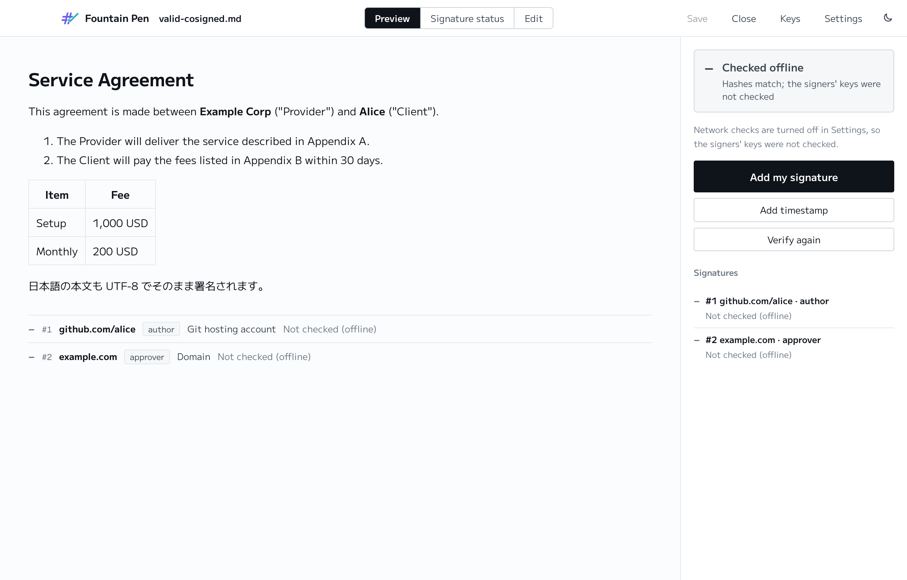

- Verifies on open and shows the result in plain sentences, outside the document
- Warns about content that looks different from what is signed, such as hidden comments and bidi controls (SPEC 9.5)
- Signs with a GitHub account, a domain, an OpenPGP key, a passkey, and more; creates a key in the app and keeps it in the system keychain if you have none
- Keys seen for the first time are trusted only after you check the fingerprint, as with SSH
- An edit mode that cannot break signed ranges
- Japanese and English, light and dark

Runs on macOS (13 or later) and Windows (10 or later, WebView2). Not published to a store yet.

## Contents

- [Install](#install)
- [Open a document](#open-a-document)
- [Warnings about content that may not appear as written](#warnings-about-content-that-may-not-appear-as-written)
- [Signature status](#signature-status)
- [Sign](#sign)
- [Set up a key](#set-up-a-key)
- [Sign with a passkey](#sign-with-a-passkey)
- [Trusting a key seen for the first time](#trusting-a-key-seen-for-the-first-time)
- [Edit](#edit)
- [Settings and appearance](#settings-and-appearance)
- [Relation to the mdsig command](#relation-to-the-mdsig-command)
- [Development](#development)

## Install

Download from [Releases](https://github.com/SHIOZAKI-Shota/mdsig_fountain-pen/releases):

| OS | File |
| --- | --- |
| macOS | `Fountain.Pen_<version>_universal.dmg` |
| Windows | `Fountain.Pen_<version>_x64-setup.exe` or `.msi` |

The app is not code-signed or notarized yet, so the OS warns on first launch.

- macOS: Control-click the app and choose Open.
- Windows: on the SmartScreen screen, choose "More info", then "Run anyway".

## Open a document

Drop a `.md` file on the window or press "Open a file". "Open with" in Finder or Explorer works too, and recent files are listed on the start screen.

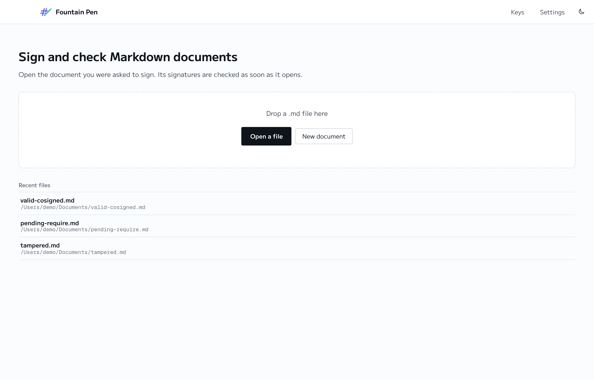

Signatures are verified as soon as the file opens, and the result appears on the right. It is drawn outside the document, so text in the document that says "verified" cannot fake it.

## Warnings about content that may not appear as written

A signature covers the Markdown source, not what a renderer shows. A clause inside a hidden comment, or digits reordered with bidi controls, can make what the signer read differ from what they signed. When the app finds such content, the right side lists it with a count per kind.

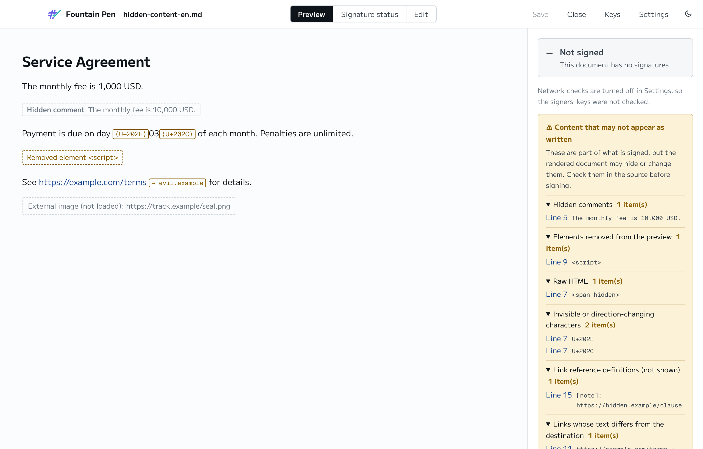

| Kind | In the preview |
| --- | --- |
| Hidden comments | Shown as "Hidden comment" with their text |
| Elements removed from the preview (such as `<script>`) | Shown as "Removed element `<script>`" |
| Raw HTML | Drawn without `hidden` and `style`, so hidden text shows |
| Invisible or direction-changing characters | Marked as `⟨U+202E⟩` |
| Link reference definitions | Listed in the warning only |
| Links whose text differs from the destination | `→ evil.example` next to the link |
| External images | Never loaded; the URL is shown |

Click "Line n" to open the source at that line. The source view also shows invisible characters as `⟨U+202E⟩`, so you can see what is really written.

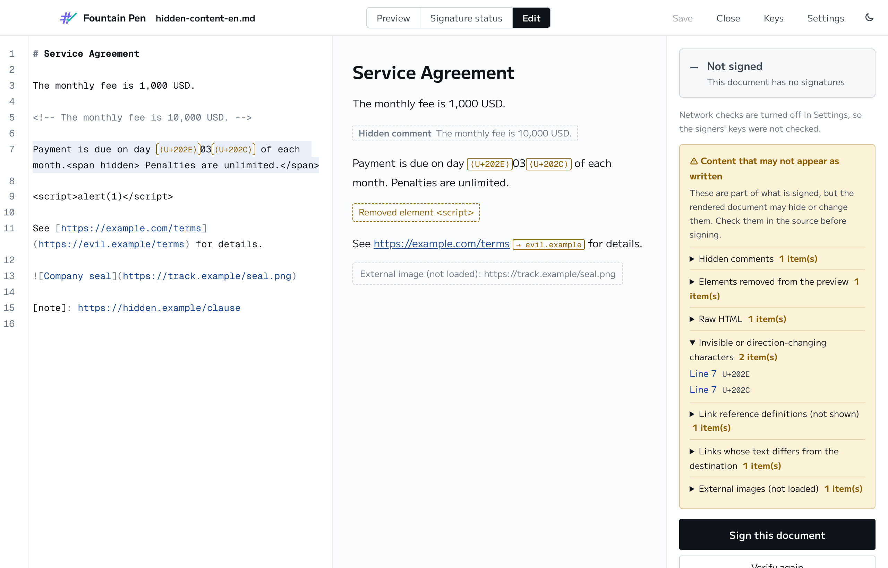

The sign form shows the same warning, with a "Check the source" button.

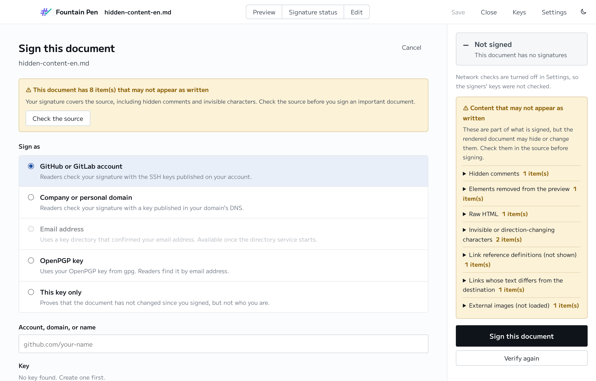

## Signature status

"Signature status" shows each signature's result and what it covers.

- **Signatures**: signer, role, method, claimed signing time, timestamp from a time-stamping authority, where the key came from
- **Ranges**: a bracket from line 1 to the signature for a whole-document signature, or around the covered sections for a partial one
- **Required**: how far the co-signatures requested with `require` have come

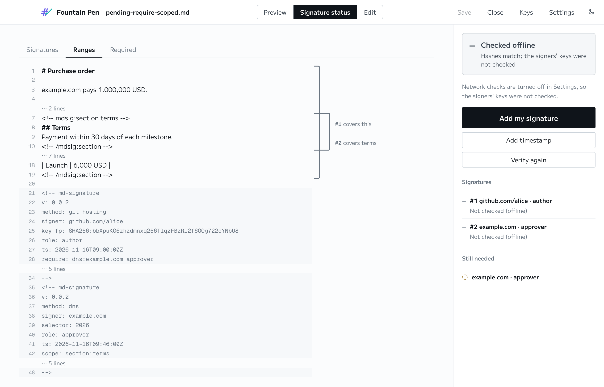

Results are plain sentences: `hash-mismatch` reads "The document was changed after this signature", and the code itself is in the details.

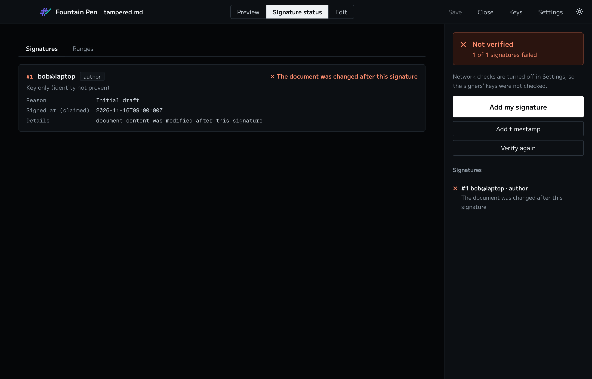

## Sign

Press "Sign this document" ("Add my signature" when it is already signed) on the right.

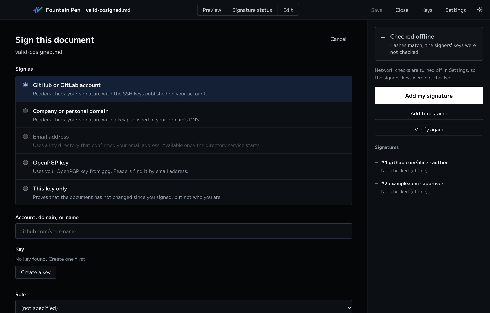

1. Choose how you sign: a GitHub or GitLab account, a company or personal domain, an email address (key directory), an OpenPGP key, or this key only (does not prove who you are). To sign with an email address, register your key with a key directory and open the link in the confirmation email. Register from the key setup screen, or with "Register this key with a key directory" on the signing screen. The key goes to the directory named by the `_mdsig` record of your email domain, or else to the first directory in Settings.
2. Enter your account or domain. The key is chosen for you.
3. Optionally add a role and a comment. A timestamp from a time-stamping authority is added by default. Expiry, partial signatures, and signatures still needed are under "More options".
4. Press "Sign" and save the file.

When you sign as a GitHub account and the chosen key is not on that account, the app asks before signing. A document with text after the last signature that nobody signed cannot be signed as it is, so your signature does not appear to approve that text on behalf of the earlier signers.

## Set up a key

If no key is found, choose "Create a key". The key is kept in the system keychain (macOS Keychain, Windows Credential Manager); only the public part is shared.

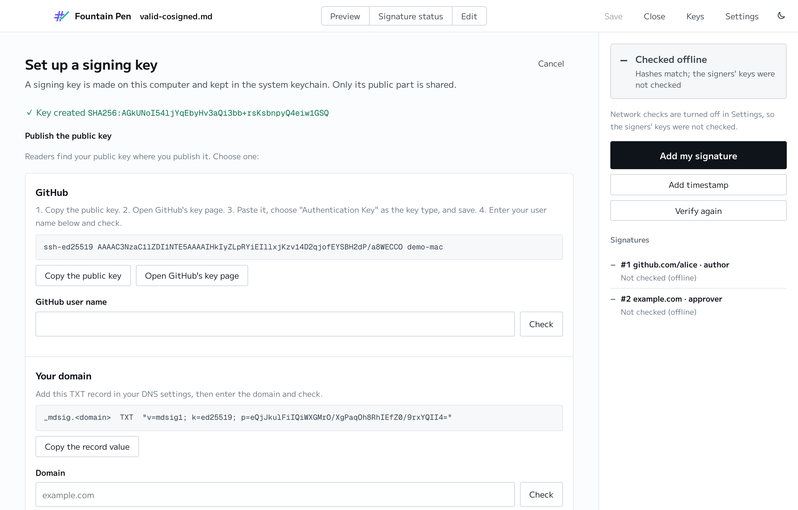

The next screen shows where to publish the public key:

- **GitHub**: copy the key, open GitHub's key page, and paste it. Enter your user name and press "Check" to confirm it is published.
- **Your domain**: add the TXT record value at `_mdsig.<domain>` and press "Check".
- **mdsig command line**: save the key to `~/.ssh` to use it from the command line too.

Existing keys are used in the same order as the mdsig command: the SSH key file from Settings, `~/.ssh/id_ed25519` (passphrase-protected keys too), ssh-agent, then keys made in the app. OpenPGP uses your gpg keys. "Keys" (top right) lists saved keys and lets you copy, export, or delete them.

## Sign with a passkey

A passkey works only on pages of the site it was registered with (its RP ID). The app asks a **signing page**, opened in your browser, to make the passkey signature (CLI_SPEC section 8). The signing page does not have to be on mdsig.dev: choose one from a key directory or any site.

1. In Keys (top right), choose a signing page and press "Connect a passkey". The page opens in your browser; choose or create a passkey there.
2. In the sign form, choose "This key only" or "Company or personal domain", and pick the connected passkey as the key.
3. Press "Sign". The signing page opens in your browser; check what it shows and sign with Touch ID, Windows Hello, or similar. You come back to the app and the signature is appended.

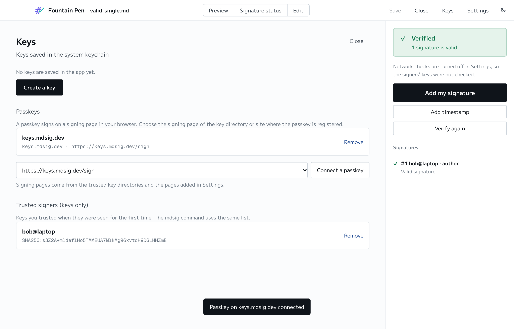

The app sends the signing page only the fields to sign and the hash, never the document text. The signature that comes back is checked against what was sent and the public key from when the passkey was connected, and is appended only if it verifies. Answers come back to `mdsig+fountain-pen://`.

The signing pages of the trusted key directories (`<directory>/sign`) are listed automatically. Add or remove other pages under Settings, "Signing pages".

## Trusting a key seen for the first time

A "this key only" (tofu) signature proves that the document has not changed, but not who signed it. The app does not trust a key it sees for the first time on its own. As with a new SSH host, it shows the fingerprint and asks you.

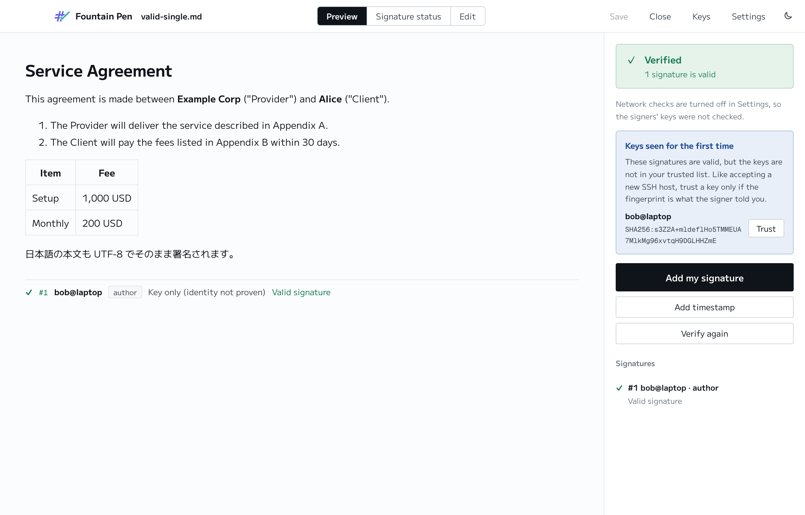

Press "Trust" if the fingerprint is what the signer told you. Later documents from the same signer with a different key are reported as "The signer's key differs from the one seen before". Trusted signers are listed in Keys, where you can remove them; the list is shared with the mdsig command (`known_signers.json`).

## Edit

"Edit" shows the source and the preview side by side. What you can change depends on the signatures:

| Document | What you can edit |
| --- | --- |
| Not signed (including new documents) | Everything |
| Only partial signatures | Everything except the signed sections and the signature blocks |
| Has a whole-document signature | Nothing (read-only) |

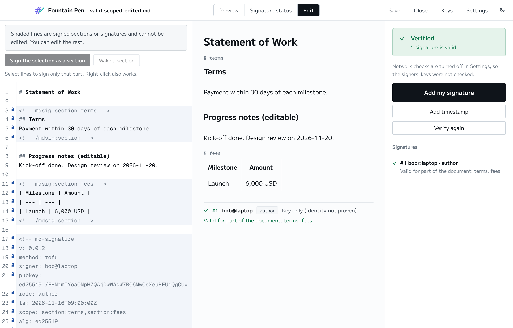

Shaded lines with a lock cannot be edited. Pastes and replacements that reach into a signed range are refused as well.

### Sign a selection

To sign only part of a document, select the lines in the editor and press "Sign the selection as a section" in the toolbar, or choose it from the right-click menu.

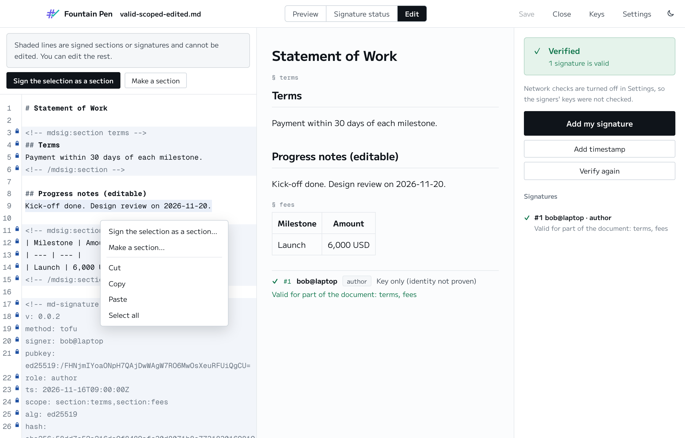

1. Enter a section ID (lower-case letters, digits, and hyphens). The suggestion comes from a heading in or just above the selection.
2. Section markers (`<!-- mdsig:section <id> -->` and `<!-- /mdsig:section -->`) are inserted around the selected lines.
3. The sign form opens with that section selected.

A partial signature covers only its sections, so the text outside them can still be edited and the signature stays valid. Nested sections, duplicate IDs, and selections that overlap signed text or a code block are refused. "Make a section" only inserts the markers. The preview shows `§ <id>` where each section starts.

## Settings and appearance

Under Settings (top right). The sun and moon icon in the title bar also switches between light and dark mode.

- Language (Japanese, English, or the system setting) and appearance (light, dark, or the system setting)
- Network use during verification, revocation checks, downloading files on the internet that a document refers to (off by default)
- Showing hidden comments and invisible characters in the preview
- Time-stamping authority URL and additional root certificates
- Key directories (the same list as `mdsig directory trust`) and signing pages, added or removed
- OpenPGP keyserver, SSH key file

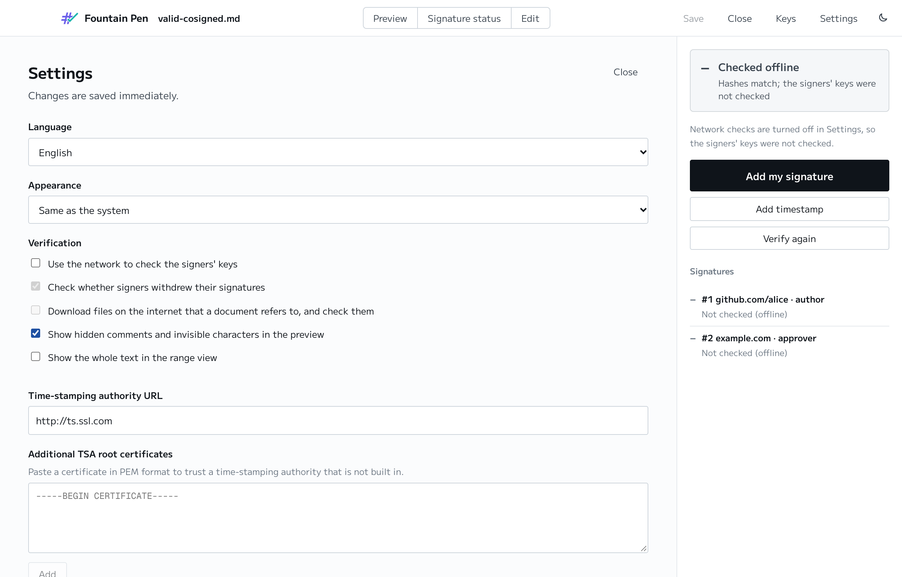

The app draws its own title bar. On macOS it keeps the traffic-light buttons; on Windows it has its own minimize, maximize, and close buttons.

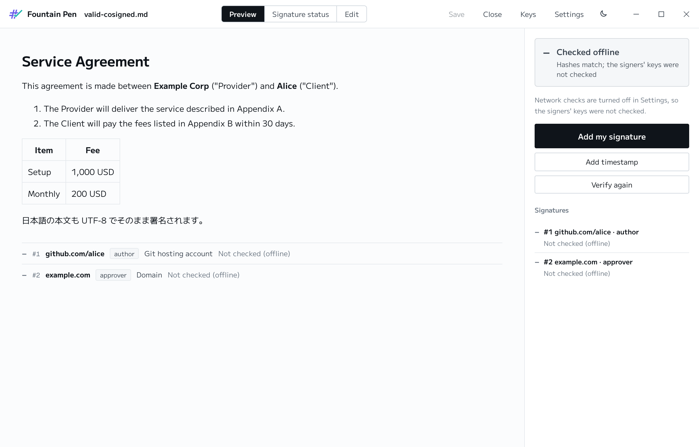

## Relation to the mdsig command

Verification uses [`@mdsig/core`](https://www.npmjs.com/package/@mdsig/core), so the results match the mdsig command and the [VS Code extension](https://github.com/SHIOZAKI-Shota/mdsig_VSCode-extension). Trusted signers (`known_signers.json`) and trusted key directories (`key_directories.json`) are the same files the mdsig command uses.

## Development

```sh
npm install
npm run app:dev        # Tauri dev mode
npm run typecheck && npm test
cargo test --manifest-path src-tauri/Cargo.toml
npm run app:build      # .app / .dmg / .msi
```

`npm run dev` and `http://localhost:3000/?mock&doc=valid-cosigned.md` show the UI in a browser without Tauri (development only, using the documents in `test/examples` and `test/mock`). Add `&lang=en` or `&platform=win` to switch the language or the title bar.

Built with Tauri 2 and Nuxt 4 (SPA). Signing and verification run in the WebView with `@mdsig/core`; the Rust side handles only files, the keychain, ssh-agent, and gpg.

## License

MIT
