# Fountain Pen

[md-signature](https://mdsig.dev/) 形式の署名付き Markdown を検証・署名するデスクトップアプリです。署名を依頼された Markdown ファイルを開くと既存の署名を即時に検証し、ボタン操作で自分の署名を追記できます。端末やコマンドの知識は不要です。

[English](README.en.md)

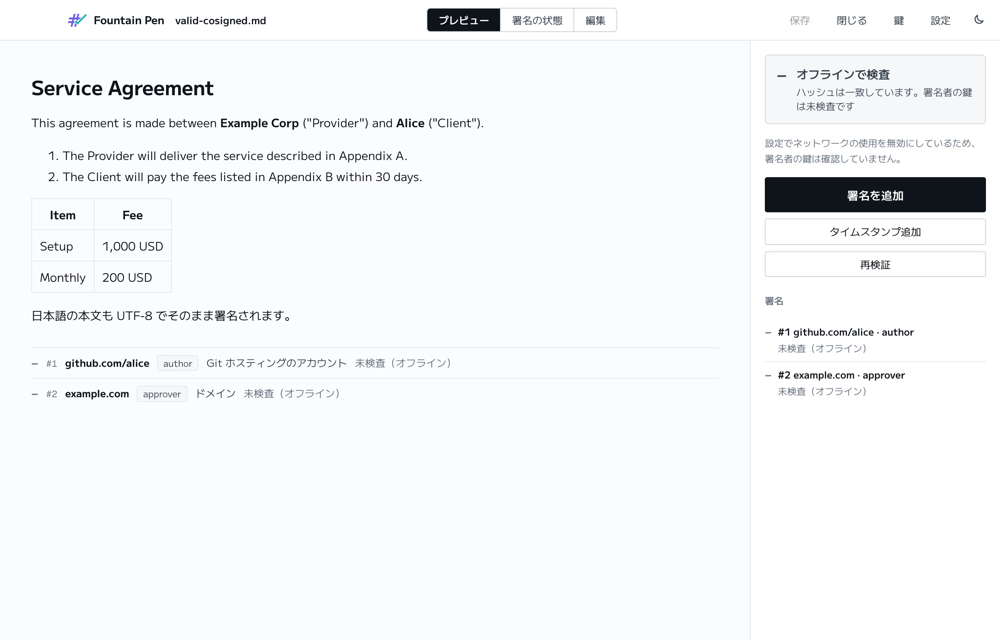

- 開いた時点で署名を検証し、結果を本文の外側に平易な文で表示
- 表示されないコメントや双方向制御文字など、見た目と署名対象が食い違う内容を警告（SPEC 9.5）
- GitHub アカウント、ドメイン、OpenPGP 鍵、パスキーなどで署名。鍵がなければアプリ内で生成し、OS の鍵保管庫に保存
- 初めて検出した鍵は、SSH と同じくフィンガープリントを確認して信頼
- 署名済みの範囲を壊さない編集モード
- 日本語・英語、ライト・ダークモード

対応 OS は macOS（13 以降）と Windows（10 以降、WebView2）です。まだストアには公開していません。

## 目次

- [インストール](#インストール)
- [文書を開く](#文書を開く)
- [表示と異なる可能性のある内容の警告](#表示と異なる可能性のある内容の警告)
- [署名の状態](#署名の状態)
- [署名する](#署名する)
- [鍵の準備](#鍵の準備)
- [パスキーで署名する](#パスキーで署名する)
- [初めて検出した鍵の信頼](#初めて検出した鍵の信頼)
- [編集](#編集)
- [設定と外観](#設定と外観)
- [mdsig コマンドとの関係](#mdsig-コマンドとの関係)
- [開発](#開発)

## インストール

[リリース](https://github.com/SHIOZAKI-Shota/mdsig_fountain-pen/releases)から次のファイルを取得してください。

| OS | ファイル |
| --- | --- |
| macOS | `Fountain.Pen_<版>_universal.dmg` |
| Windows | `Fountain.Pen_<版>_x64-setup.exe` または `.msi` |

コード署名と公証はまだ行っていないため、初回起動時に OS の警告が表示されます。

- macOS：アプリを Control キーを押しながらクリックし、「開く」を選択します。
- Windows：SmartScreen の画面で「詳細情報」から「実行」を選択します。

## 文書を開く

`.md` ファイルをウィンドウにドロップするか、「ファイルを開く」を押します。Finder やエクスプローラーで「このアプリで開く」を選択しても開けます。最近使用したファイルは最初の画面から開き直せます。

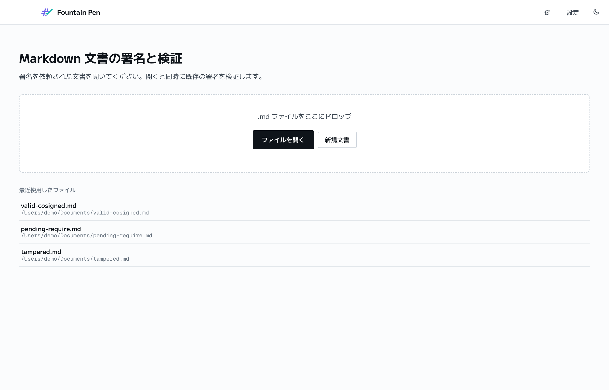

開くと同時に署名を検証し、右側に結果を表示します。検証結果は本文とは別の領域に出すため、本文に「検証済み」と書かれていても結果の表示を偽装できません。

## 表示と異なる可能性のある内容の警告

署名の対象は Markdown のソース全体で、レンダリング結果ではありません。表示されないコメントに条項を書いたり、双方向制御文字で数字の並びを入れ替えたりすれば、署名者が読んだ内容と署名の対象を食い違わせることができます。このアプリは、そうした内容を見つけると右側に種類ごとの件数を警告します。

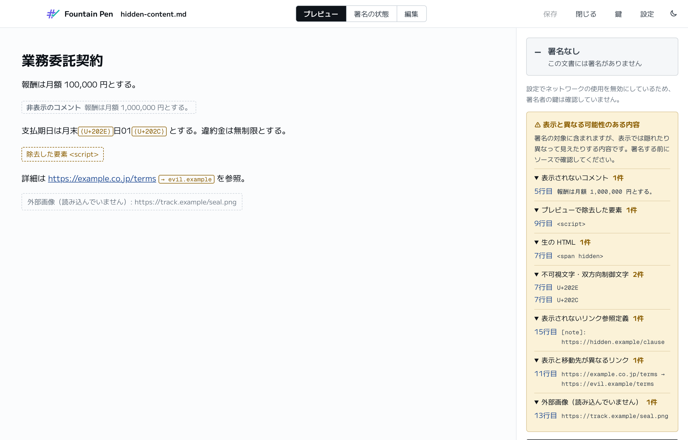

| 種類 | プレビューでの表示 |
| --- | --- |
| 表示されないコメント | 「非表示のコメント」として中身を表示 |
| プレビューで除去した要素（`<script>` など） | 「除去した要素 `<script>`」と表示 |
| 生の HTML | `hidden` や `style` を外して中身を表示 |
| 不可視文字・双方向制御文字 | `⟨U+202E⟩` の形で強調 |
| 表示されないリンク参照定義 | 警告の一覧のみ |
| 表示と移動先が異なるリンク | リンクの横に `→ evil.example` を表示 |
| 外部画像 | 読み込まず、URL を表示 |

一覧の「◯行目」を押すと、編集画面のソースの該当行に移動します。ソース上でも不可視文字を `⟨U+202E⟩` の形で表示するので、実際に何が書かれているかを確認できます。

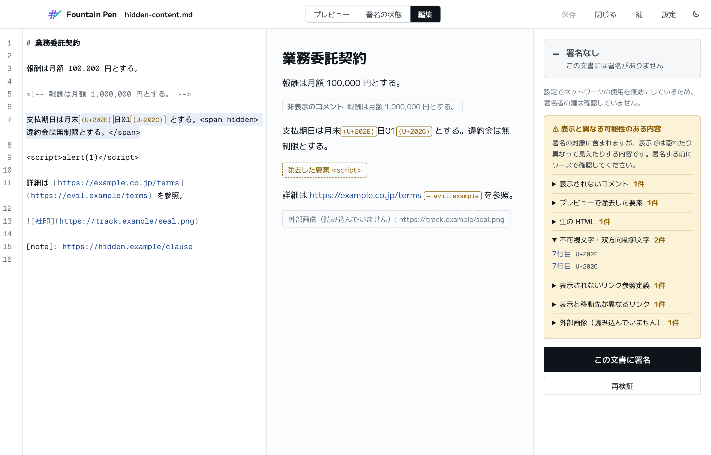

署名フォームにも同じ警告を表示し、「ソースを確認」から該当箇所に移動できます。

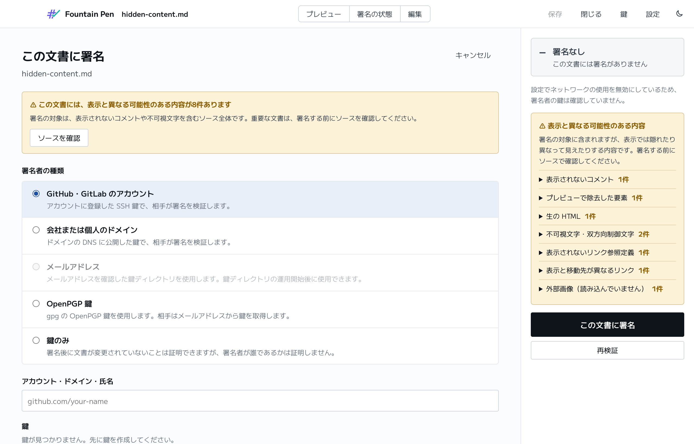

## 署名の状態

「署名の状態」では、署名ごとの結果と各署名の対象範囲を確認できます。

- **署名**：署名者、役割、方式、申告された署名時刻、時刻認証局のタイムスタンプ、鍵の取得元
- **範囲**：全文署名なら1行目から署名の直前まで、部分署名なら対象のセクションだけに括弧を表示
- **必要な署名**：`require` で指定された連署の進み具合

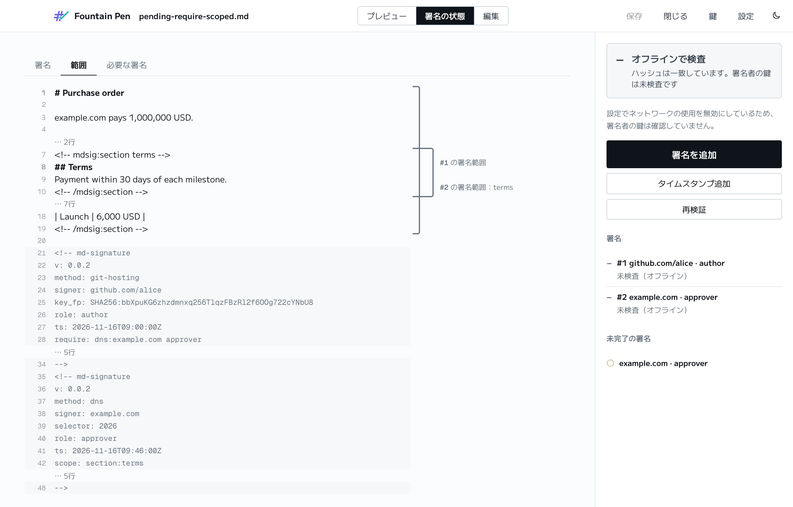

結果は平易な文で表示します。たとえば `hash-mismatch` は「この署名の後に文書が変更されています」と表示し、コード名は詳細欄に置きます。

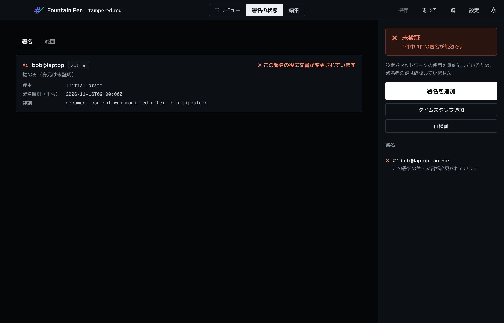

## 署名する

右側の「この文書に署名」（署名済みの文書では「署名を追加」）を押すと、署名フォームが開きます。

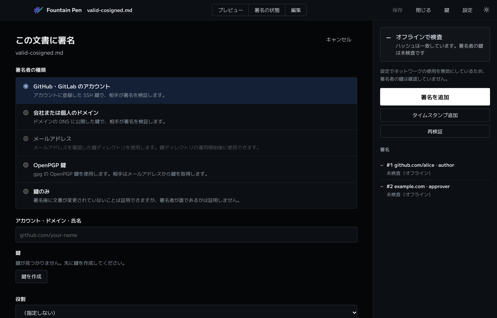

1. 「署名者の種類」を選択します。GitHub・GitLab のアカウント、会社または個人のドメイン、メールアドレス（鍵ディレクトリ）、OpenPGP 鍵、鍵のみ（身元は証明されません）から選べます。メールアドレスで署名するには、鍵を鍵ディレクトリに登録し、確認メールのリンクを開いておきます。登録は「鍵の準備」画面、または署名画面の「この鍵を鍵ディレクトリに登録」から行います。送信先は、メールのドメインの `_mdsig` レコードが指定する鍵ディレクトリ、指定がなければ設定の一覧の先頭です。
2. アカウント名やドメインを入力します。鍵は自動で選択されます。
3. 必要なら役割とコメントを入力します。時刻認証局のタイムスタンプは既定で付与されます。期限、部分署名、後続の必要な署名は「詳細設定」にあります。
4. 「署名」を押し、表示に従って保存します。

GitHub アカウントで署名する場合、選択した鍵がそのアカウントに登録されていなければ、署名前に確認を求めます。最後の署名の後に誰も署名していない文章がある文書には、そのままでは署名できません。前の署名者がその文章を承認したように見えるのを防ぐためです。

## 鍵の準備

鍵が見つからない場合は「鍵を作成」から鍵を生成します。鍵は OS の鍵保管庫（macOS のキーチェーン、Windows の資格情報マネージャ）に保存し、公開鍵だけを共有します。

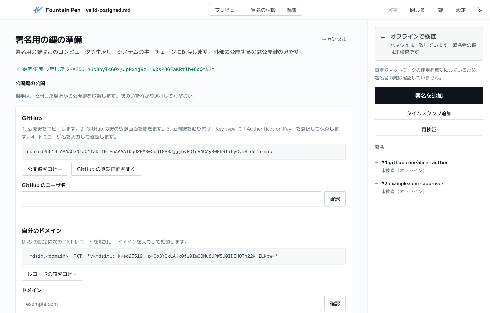

生成後の画面で公開鍵の登録先を案内します。

- **GitHub**：公開鍵をコピーし、GitHub の鍵の登録画面を開いて貼り付けます。ユーザ名を入力して「確認」を押すと、登録できたかを検証します。
- **ドメイン**：表示された TXT レコードの値を `_mdsig.<ドメイン>` に登録し、「確認」を押します。
- **mdsig コマンド**：`~/.ssh` に書き出して、コマンドラインでも同じ鍵を使えます。

既存の鍵も使用します。探す順序は mdsig コマンドと同じで、設定の SSH 鍵ファイル、`~/.ssh/id_ed25519`（パスフレーズ付きも可）、ssh-agent、このアプリで作成した鍵です。OpenPGP は gpg の鍵を使用します。保存済みの鍵は右上の「鍵」で一覧、コピー、書き出し、削除ができます。

## パスキーで署名する

パスキーは、登録したサイト（RP ID）のページでしか使えません。このアプリはパスキーの署名を、ブラウザで開く**署名ページ**に依頼します（CLI_SPEC 8 節）。署名ページは mdsig.dev に限らず、鍵ディレクトリや任意のサイトのものを選べます。

1. 右上の「鍵」で署名ページを選び、「パスキーを接続」を押します。ブラウザで署名ページが開くので、パスキーを選択または作成します。
2. 署名フォームで「鍵のみ」または「会社または個人のドメイン」を選び、鍵の一覧から接続したパスキーを選択します。
3. 「署名」を押すとブラウザで署名ページが開きます。表示された内容を確認し、Touch ID や Windows Hello などで署名すると、自動でアプリに戻り、署名が追記されます。

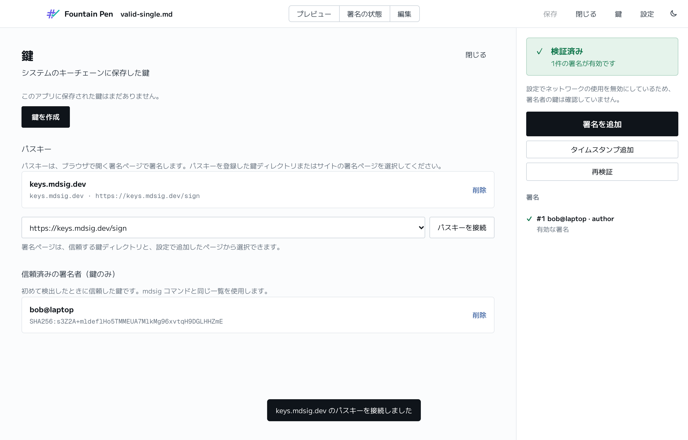

アプリから署名ページに送るのは、署名対象のフィールドとハッシュだけで、文書の本文は送りません。戻ってきた署名は、送った内容と接続時の公開鍵に対して検証し、成立した場合に限り追記します。戻り先は `mdsig+fountain-pen://` です。

署名ページの一覧には、信頼する鍵ディレクトリの署名ページ（`<ディレクトリ>/sign`）が自動で入ります。ほかのページは「設定」の「署名ページ」で追加・削除できます。

## 初めて検出した鍵の信頼

「鍵のみ」（tofu）の署名は、文書が改変されていないことは証明しますが、署名者が誰かは証明しません。このアプリは、初めて検出した鍵を自動では信頼しません。SSH で初めて接続するサーバと同じく、フィンガープリントを示して確認を求めます。

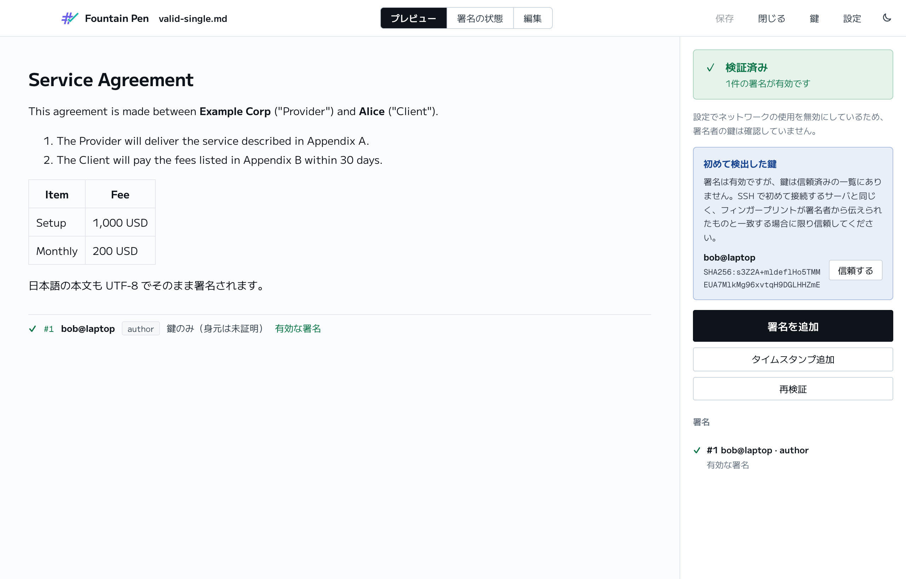

フィンガープリントが署名者から伝えられたものと一致する場合に「信頼する」を押してください。以後、同じ署名者が別の鍵で署名した文書は「署名者の鍵が、以前に記録した鍵と異なります」と警告されます。信頼済みの署名者は「鍵」の画面で一覧・削除でき、一覧は mdsig コマンドと共有します（`known_signers.json`）。

## 編集

「編集」では、ソースとプレビューを並べて文書を修正できます。編集できる範囲は署名の状態で決まります。

| 文書 | 編集できる範囲 |
| --- | --- |
| 署名のない文書（新規文書を含む） | 全体 |
| 部分署名だけの文書 | 署名済みのセクションと署名ブロック以外 |
| 全文署名のある文書 | なし（読み取り専用） |

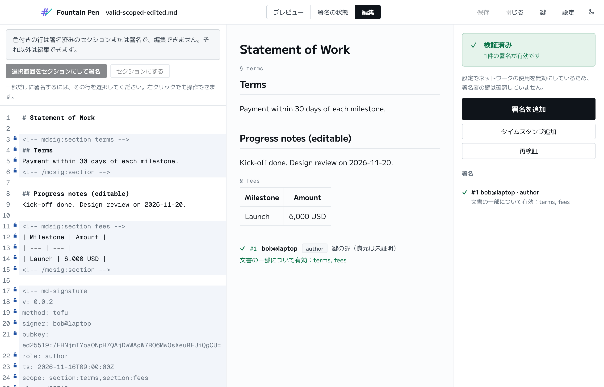

色付きで錠の印が付いた行は編集できません。貼り付けや一括置換で署名済みの範囲に掛かる変更も受け付けません。

### 選択範囲に署名する

文書の一部だけに署名するには、編集画面で対象の行を選択し、ツールバーの「選択範囲をセクションにして署名」を押します。右クリックのメニューからも選べます。

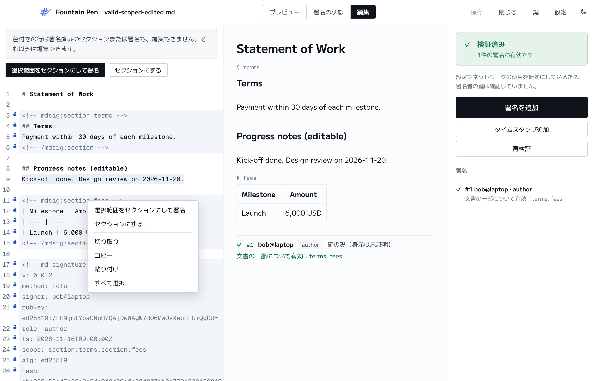

1. セクション ID（英小文字、数字、ハイフン）を入力します。候補は、選択範囲またはその直前の見出しから作成します。
2. 選択した行の前後にセクションの印（`<!-- mdsig:section <ID> -->` と `<!-- /mdsig:section -->`）を挿入します。
3. そのセクションを対象に選択した状態で署名フォームが開きます。

部分署名は、そのセクションだけを対象にします。署名後もセクションの外は編集でき、署名は有効なままです。セクションの入れ子、ID の重複、署名済みの範囲やコードブロックとの重なりは受け付けません。「セクションにする」は印の挿入だけを行います。プレビューでは、セクションの開始位置に `§ <ID>` を表示します。

## 設定と外観

右上の「設定」で次を変更できます。ライトモードとダークモードは、タイトルバーの太陽・月のアイコンでも切り替えられます。

- 表示言語（日本語、英語、システムの設定に従う）と外観（ライト、ダーク、システムの設定に従う）
- 検証時のネットワーク使用、撤回の確認、文書が参照するインターネット上のファイルの取得（既定は無効）
- プレビューでの非表示のコメントと不可視文字の表示
- 時刻認証局の URL と追加のルート証明書
- 鍵ディレクトリ（mdsig コマンドの `mdsig directory trust` と同じ一覧）と署名ページの追加・削除
- OpenPGP 鍵サーバ、SSH 鍵ファイル

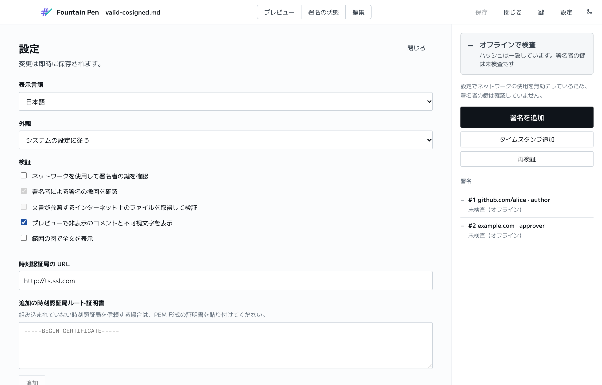

タイトルバーはアプリが描画します。macOS では左上の信号ボタンをそのまま使い、Windows では右上に最小化・最大化・閉じるのボタンを表示します。

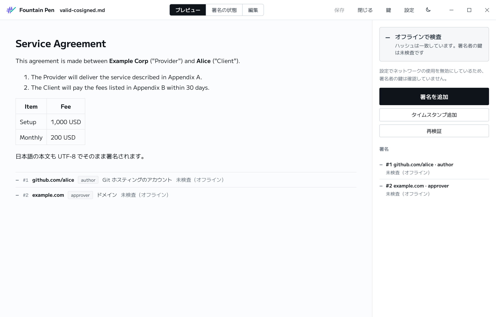

## mdsig コマンドとの関係

検証には [`@mdsig/core`](https://www.npmjs.com/package/@mdsig/core) を使用しているため、結果は mdsig コマンドや [VS Code 拡張](https://github.com/SHIOZAKI-Shota/mdsig_VSCode-extension)と同じです。信頼済みの署名者（`known_signers.json`）と信頼する鍵ディレクトリ（`key_directories.json`）は、mdsig コマンドと同じファイルを共有します。

## 開発

```sh
npm install
npm run app:dev        # Tauri の開発モード
npm run typecheck && npm test
cargo test --manifest-path src-tauri/Cargo.toml
npm run app:build      # .app / .dmg / .msi
```

`npm run dev` を実行して `http://localhost:3000/?mock&doc=valid-cosigned.md` を開くと、Tauri なしでブラウザ上に画面を表示できます（開発時のみ、`test/examples` と `test/mock` の文書を使用）。`&lang=en`、`&platform=win` で表示言語とタイトルバーを切り替えられます。

構成は Tauri 2 と Nuxt 4（SPA）です。署名と検証は WebView 内の `@mdsig/core` が行い、Rust 側はファイル、鍵保管庫、ssh-agent、gpg だけを扱います。

## ライセンス

MIT
